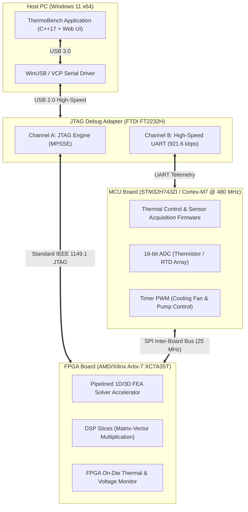

# ThermoBench — Embedded System Architecture & Hardware Mock Design

## 1. System Overview
ThermoBench interfaces with embedded electronics for real-time thermal management and hardware-accelerated finite element numerics. In testing and evaluation environments where physical target hardware is absent, ThermoBench provides robust C++ mock adapters that simulate hardware behavior, telemetry streaming, fault injection (watchdog timeouts), and automated recovery with bus re-enumeration.

---

## 2. Voltage Domains & Level Shifting

| Power Rail | Nominal Voltage | Tolerance | Supply Source | Description / Subsystems Powered |
|------------|-----------------|-----------|---------------|----------------------------------|
| `VBUS_USB` | 5.00 V | $\pm 5\%$ | Host USB Port | Main input power rail from host PC |
| `VCC_3V3`  | 3.30 V | $\pm 2\%$ | LDO / Buck (TPS62130) | MCU core I/O, FTDI adapter, external SPI flash |
| `VCC_1V8`  | 1.80 V | $\pm 2\%$ | Buck Converter | FPGA Auxiliary `VCCAUX`, JTAG I/O bank, Level Shifter B-side |
| `VCC_1V0`  | 1.00 V | $\pm 1.5\%$ | Synchronous Buck | FPGA Core Logic `VCCINT` |
| `GND`      | 0.00 V | Reference | Common Ground Plane | Solid low-impedance copper ground plane |

### Level Shifting Architecture
- **MCU $\leftrightarrow$ FPGA Interface:** MCU GPIO operates at $3.3\text{ V}$, whereas high-speed FPGA I/O banks operate at $1.8\text{ V}$.
- **Transceiver:** Texas Instruments **TXS0108E** (8-channel bidirectional auto-sensing level translator with open-drain and push-pull drive capability).
  - Port A: $V_{CCA} = 3.3\text{ V}$ (STM32H7 GPIOs)
  - Port B: $V_{CCB} = 1.8\text{ V}$ (Artix-7 Bank 14/15 I/O)

---

## 3. Physical Interface Pinout & JTAG Signal Map

| Signal Name | JTAG / Bus Pin | MCU Pin | FPGA Pin | Direction | Signal Type | Description |
|-------------|---------------|---------|----------|-----------|-------------|-------------|
| **`TCK`**   | Pin 1 | PA14 (SWCLK) | Dedicated TCK | Host $\to$ Target | 1.8V CMOS | JTAG Test Clock (up to 30 MHz) |
| **`TMS`**   | Pin 2 | PA13 (SWDIO) | Dedicated TMS | Host $\to$ Target | 1.8V CMOS | JTAG Test Mode Select |
| **`TDI`**   | Pin 3 | PA15 (TDI)   | Dedicated TDI | Host $\to$ Target | 1.8V CMOS | JTAG Test Data In |
| **`TDO`**   | Pin 4 | PB3 (TDO)    | Dedicated TDO | Target $\to$ Host | 1.8V CMOS | JTAG Test Data Out |
| **`TRST`**  | Pin 5 | PB4 (TRST)   | Dedicated TRST| Host $\to$ Target | 1.8V CMOS | JTAG Test Reset (active-low) |
| **`VREF`**  | Pin 6 | VDD_IO       | VCCO_0        | Target $\to$ Host | 1.8V Analog | Voltage reference for adapter level matching |
| **`GND`**   | Pin 7/8| GND         | GND           | Common            | Ground      | System signal return ground |
| **`UART_TX`**| Header Pin 1| USART1_TX (PA9)| — | MCU $\to$ Host | 3.3V CMOS | Telemetry transmit (921,600 baud, 8N1) |
| **`UART_RX`**| Header Pin 2| USART1_RX (PA10)| — | Host $\to$ MCU | 3.3V CMOS | Command receive |
| **`SPI_SCK`**| Inter-board | SPI1_SCK (PA5)| Bank 14 Pin E1 | MCU $\to$ FPGA | 1.8V (shifted) | Inter-board clock (25 MHz) |
| **`SPI_MOSI`**| Inter-board | SPI1_MOSI (PA7)| Bank 14 Pin E2| MCU $\to$ FPGA | 1.8V (shifted) | Master Out Slave In |
| **`SPI_MISO`**| Inter-board | SPI1_MISO (PA6)| Bank 14 Pin E3| FPGA $\to$ MCU | 1.8V (shifted) | Master In Slave Out |

---

## 4. Timeout and Automated Fault Recovery
In industrial thermal management, serial links and bus transactions are subject to electrical transients, watchdog events, or cable disconnects. ThermoBench simulates this via:
1. **Fault Injection (`trigger_timeout`):** Artificially forces a device into a communication timeout / unacknowledged state.
2. **Detection:** Host driver detects missed heartbeat packets ($> 500\text{ ms}$).
3. **Automated Recovery (`recover_device`):**
   - Step 1: Flushes host communication ring buffers.
   - Step 2: Pulses hardware reset line (via simulated GPIO toggle).
   - Step 3: Re-negotiates baud rate / bus frequency with exponential backoff ($50\text{ ms} \to 100\text{ ms} \to 200\text{ ms}$).
   - Step 4: Re-synchronizes frame counter and returns to full operational telemetry streaming.
